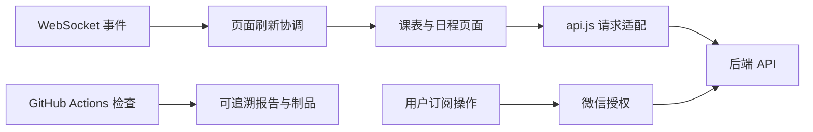

# agent.md — 成员 C｜小程序、部署与文档工作守则

> 版本：v1.3｜更新日期：2026-10-11｜状态：仅在本地维护，不纳入 Git；任务 Issue 已建立，仓库实现进度待核验。  
> 依据：用户提供的 `C-miniprogram-deploy.md`、另外两端任务书及全部考核要求。  
> 范围：微信小程序、实时刷新、订阅入口、部署复现、文档集成、CI 与演示。工作分支：`feat/miniprogram`，从核验后的 `develop` 创建。

**使用方式**：把本文件作为本成员 AI 编程会话的本地工作上下文，随进度更新，但不纳入 Git 管理。三份同名文件分别保存在各自本地目录中，不能相互覆盖；会话开始时显式提供文件或要求助手读取，不假设小写 `agent.md` 会被自动加载。本文件中 `docs/`、`scripts/` 等路径均相对于项目仓库根目录，是待落实的交付路径，不代表文件已经存在。

**Git 排除约定**：优先把这三份守则放在项目仓库之外；如放入仓库工作区，将各文件的实际相对路径加入该克隆的本地排除配置（通常为 `.git/info/exclude`），并用 `git check-ignore -v -- <文件路径>` 核验。禁止暂存、提交、强制添加这三份文件，不因更新守则创建 commit 或 PR。排除规则对已跟踪文件不生效；若发现已被跟踪，需单独核实并处理索引状态，保留本地文件。此约定仅针对三份本地守则，项目代码、测试、正式文档及考核证据仍按既定 Git 规范管理。

**Issue 使用约定**：用户已确认按任务书建立了 Issue，直接关联、更新现有记录，不重复创建。下表的“待核验”指实现与验收状态；具体 Issue 编号和链接尚未提供，关联后填写，不编造编号。任务名称或验收表述需调整时优先更新对应 Issue，保留讨论与变更记录。

## 1. 角色、架构与启动顺序

你负责 `miniprogram/`、部署脚本/配置示例、共享文档集成、`.github/workflows/` 和演示组织。A/B 必须交付自己模块的测试、图文、环境及重构数据，不把全部写作和证明责任转交给 C。



任务书称小程序尚未创建、后端 M1 已就绪；本轮未访问仓库或微信账号，均待核验。账号、AppID、模板、开发者工具与真机权限列为前置，不由 AI 假定具备。

优先顺序：核验 → C1；C5 文档框架/CI 可先做；C2 依赖 B1，C3 依赖 B3；C4 先准备本地路线，公网联调和最终视频待接口稳定。

| 任务 | 初始估算 | 当前状态 | 依赖/下一步 | Issue / PR / 验收证据 |
|---|---:|---|---|---|
| C1 骨架与 api.js | 5 | 已完成 | 已随 PR #22 合入 develop（合并提交 ee1a638）；CI 绿、开发者工具与真机实际使用验证 | Issue #9（待手动关闭）；PR #22 |
| C2 实时刷新 | 3 | 待评审 | 真机验收已通过（2026-10-14）；新开 PR #25 → develop 待评审合并 | Issue #10；PR #25；适配层逻辑验收 7/7 + 真机人工确认 |
| C3 订阅授权 | 3 | 进行中（真机链路阻塞） | 小程序侧完成（subscribe.js + 表单提醒时间 + 3 项逻辑测试入 CI）；真机验证阻塞于 B3 PR #29 合并与微信模板配置 | Issue #11；提交 `36edf56`；逻辑验收 3/3 |
| C4 部署 | 5 | 待评审 | 三路线手册 + 启停/自检/重置脚本完成；本地路线与自检实测 5/5；穿透与学生机路线待具备条件执行 | Issue #12；提交 `8d9d5d1`；check_deployment 实测 |
| C5 文档/CI/演示 | 6 | 进行中 | JS 检查（ESLint + 适配层测试）已入 CI；README/手册/环境/用例/证据/工作量/演示脚本文档已交付；演示视频待本人录制 | Issue #13；提交 `e19188e`/`ae7ab69`；CI miniprogram job |

合计 22 点，包含集成与复现；若实际工作明显超载，在里程碑复盘中调配任务，不能只靠 C 延长工时。

## 2. 所有人必须遵守的工作规则

### 2.1 开工、范围和真实性

1. 先读本文件、对应任务书、仓库已有规范及相关代码，再改动。任务书里的路径、分支、测试通过数量均是历史描述，必须核验；不得把附件里的“直接开工”当作越过当前用户请求的授权。
2. 首次开工检查 `git status`、当前分支、remote、目录、依赖与测试；保留已有未提交改动。所需文件或依赖缺失时如实记录，不猜测路径、不伪造验证结果。
3. 任务书规定项目范围；本文件补充质量、协作和证据要求。当前用户明确要求优先；发现冲突先记录 Issue，继续无冲突的工作。涉及跨端契约、验收口径或公开部署安全边界的变更，须由相关负责人评审后落地。
4. 不私自修改其他成员负责的业务模块。跨端变更通过 Issue、契约、关联 PR 协调；共享配置采用最小改动并请相关成员复核。
5. 后端是课表、日程、提醒的唯一持久化数据源。客户端缓存可以存在，但不得形成独立、无法同步的业务数据库。业务状态通过 API 同步，事件只负责通知。
6. 禁止把“计划完成、Mock 通过、AI 声称通过”写成真实验收通过。每项结论附提交 SHA、环境、执行命令或操作、实际结果和证据地址。

### 2.2 编程基础、风格与配置

- Python 遵循 PEP 8；标识符使用英文，公开接口写类型注解，docstring 使用中文。通过 Ruff 的检查和格式化保持统一；行宽统一为 100，已有仓库设置不同时先形成团队决定再变更。
- JavaScript 使用 ESLint + Prettier，统一两空格缩进、分号和字符串风格；明确小程序 `wx` 等运行环境。所有文件 UTF-8，使用 `.editorconfig` 统一换行和尾部空格规则。
- 函数职责单一；界面、业务、网络和数据访问分层。复杂条件先解释边界与失败路径，再实现；不得为展示设计模式制造无用抽象。
- 配置集中加载、类型校验、缺项提示；URL、路径、时间间隔、超时、重试和环境切换均不得散落在业务逻辑中。测试使用临时路径和固定时钟，不依赖个人电脑绝对路径。
- 后端/桌宠敏感配置来自环境变量或未提交的 `.env`；非敏感默认值及字段说明放示例配置。明确环境变量、文件和默认值的优先级。小程序可访问的任何配置都不能被视为秘密。
- `.gitignore` 排除 `.env`、虚拟环境、缓存、数据库及其 WAL/SHM、日志、构建产物、录音、真实用户数据、`node_modules/` 和工具私有配置；保留无真实密钥的示例配置、锁文件及必要合法素材。
- 需要版本管理的模型、形象或音频素材逐项确认来源、许可证和大小，必要时使用 Git LFS 或单独分发；不得用忽略规则掩盖已经被追踪的敏感文件。
- 提交前使用 pre-commit 执行格式化、静态检查、尾部空格检查和密钥扫描；CI 复验。检查器配置、安装方式、使用命令写进 `CONTRIBUTING.md`，禁止以 `--no-verify` 规避失败。

### 2.3 Git 与团队协作

分支沿用 `main / develop / feat/*`。`main` 用于验收版本，`develop` 用于集成；功能分支提交 PR 到 `develop`。管理员有权限时配置分支保护及必须通过的 CI，无权限时记录限制并执行同等人工评审。

首次创建分支前可按以下顺序操作；如分支已存在应检出并核验，不能重复创建或重置它。工作区有改动时先妥善保留，不覆盖他人的工作：

```bash
git status
git remote -v
git fetch origin
git switch develop
git pull --ff-only origin develop
git switch -c <本成员功能分支>
```

- 用户已确认按任务书建立了 Issue，开工时先查找并关联现有 Issue，核对目标、范围、负责人、依赖、估算、验收方法和风险；缺少字段直接补充现有 Issue，不重复建单。新增范围或缺陷先检索现有记录，确认未覆盖后再建独立 Issue；缺陷需记录复现步骤、预期/实际行为及环境。
- A0～C5 是任务边界，不要求一个任务挤进一个巨型提交。每个提交只做一件可解释、可验证的事；不同任务、纯格式化、无关重构不得混在一起。功能及保障该功能的测试可同提交，独立测试增强可用 `test` 提交。
- **提交信息统一使用英文**，采用 `type(scope): imperative summary`；允许 `feat / fix / refactor / test / docs / chore / ci`，scope 使用 `pet / backend / miniprogram / repo` 等固定值。正文也用英文，不夹杂中文。Issue、PR 说明及项目文档统一中文，保留必要技术标识符。
- 示例：`feat(pet): add backend task tools`、`fix(backend): prevent duplicate reminder claims`、`docs(repo): document deployment steps`。禁止 `update`、`修改一下` 或一次提交覆盖整个项目。
- 提交前检查 `git diff` 与 `git diff --cached`，显式选择文件，避免盲目 `git add .`。同步他人分支不改写共享历史；不要使用破坏性重置或强制推送覆盖他人提交。
- 每个 PR 关联 Issue，说明问题、改动、验证、截图/图表、风险和配置迁移；至少一名其他成员评审。记录处理评审意见的过程，不自行冒充他人审核。
- 每人用本人账号完成自己的提交、Issue、PR 和评审。配对工作标明真实贡献者；设计和测试工作也提交文档、用例或评审记录，不允许一人代交全部成员成果。
- 小任务优先及时集成。冲突由涉及模块的成员协同解决，合并后重新运行受影响测试；验收版本打标签并记录准确 SHA。

### 2.4 软件质量、安全与 AI 编程

- 建立单元、契约、集成、三端端到端四层验证；对高风险逻辑优先覆盖失败路径。不得为了提高覆盖率添加仅复述实现的空洞测试。
- 网络请求必须有超时；重试有上限、退避和取消；写操作先解决幂等性再重试。界面与异步服务的关键线程不得被阻塞 I/O 长时间占用。
- REST 与 WebSocket 都验证身份；测试无凭证、错误凭证、过期凭证、越权和无效输入。共享 API Key 只能说明受控演示的访问保护，不能声称实现了多用户隔离。
- 公网/多用户路线需明确会话与数据归属、服务端授权、TLS、限流、请求大小限制和日志脱敏。客户端不能保存后端管理密钥；微信服务端 secret、模型 key 不进入小程序、截图、录像或日志。
- SQL 参数化，工具输入按 schema 校验；外部网页、搜索结果及模型输出均视为不可信数据。禁止让模型输出直接成为任意 shell、SQL 或任意文件访问命令。
- 依赖锁定可复现版本，保留来源、版本、用途和 SPDX 许可证标识；运行依赖漏洞检查与密钥检查。无法扫描或存在例外时明确说明原因、影响、负责人和处理期限。
- 每个非平凡 AI 辅助任务在 `docs/ai-log.md` 记录：Issue、工具/模型、日期、脱敏后的需求与关键提示、采用/拒绝内容、人工修改、验证与失败修复。不得上传真实密钥或用户隐私给模型。
- 人工必须能讲清 AI 生成代码的数据结构、算法、异常路径、并发和复杂度；至少保留一例“生成—发现问题—定位—修改—回归”的真实过程。没有发生就标“待积累”，不得编造。
- AI 可以建议与修改代码，但不能代替真实评审人、真机验收或测试结果。拒绝以大批量生成、刷提交或刷行数制造工作量。

### 2.5 量化验收、重构和文档

下列数值是**团队建议的初始质量门槛，不是教师给定分值，也不是已测结果**。首次联调前写入 `docs/quality-baseline.md`；调整必须附原因和前后数据，不能为了隐藏失败临时降低标准。

| 项目 | 初始门槛与测量口径 | 证据 |
|---|---|---|
| 必做功能 | 对应任务验收用例全部通过；可选项明确实现/延期及原因 | Issue、用例报告、版本 SHA |
| 自动化 | 格式、静态检查、单元与契约测试通过；核心非 GUI 业务模块行覆盖率目标 ≥80% | CI 链接、覆盖率报告及排除范围 |
| 安全 | 鉴权、输入校验、敏感信息检查通过；未解决的高危问题阻止公开发布 | 安全用例和漏洞处置记录 |
| 实时提醒 | 联调配置扫描间隔 ≤2 秒；从计划到期到客户端展示目标 ≤5 秒，同时报告成功率、p50/p95/max | 至少 30 次样本，含失败/超时数量，记录时间同步误差 |
| 重构增益 | 至少一项真实问题，固定环境与工作负载比较基线 SHA 与重构 SHA | `docs/refactor-report.md`、原始数据、图表 |
| 部署复现 | 另一成员从干净环境照手册跑通；记录耗时、步骤、人工干预、失败原因 | 部署复现单、日志摘要、演示版本 |

原任务书的“30 秒轮询”和“到期 10 秒/60 秒内收到”口径不一致。不得宣布两者同时满足。B 先将轮询间隔配置化，三人明确“从创建计时”还是“从到期计时”、样本量、网络环境和容差，再更新契约与验收用例。默认 30 秒配置应另报实际延迟，不得套用 ≤5 秒结论。

重构报告至少包含：原问题、方案及模式选择理由、替代方案、前后结构图、测试保护、度量方法、原始数据和结论。可测圈复杂度、重复代码、耦合点、延迟或缺陷数；时间类至少重复 5 次并说明波动。增益 `(旧值-新值)/旧值×100%` 只适用于越小越好的指标且旧值非零，覆盖率提升用百分点；结果下降或无增益也要如实记录。

文档用中文，代码标识符保持原样；提交前人工校对错别字、命令、链接、图注及术语。至少具备：

- `README.md`：用途、架构图、环境、快速开始、三端入口、演示与限制。
- `CONTRIBUTING.md`：编码、提交、分支、Issue、PR、格式化与检查规范。
- `docs/user-manual.md`：安装、配置、主要操作、故障排查、帮助与隐私说明。
- `docs/design.md`、`docs/api-contract.md`：组件/UML 图、时序图、字段与错误语义；图必须对应真实实现。
- `docs/environment.md`：OS、架构、CPU/RAM、运行时、依赖版本、设备、网络、时区、配置、数据规模及测试 SHA。
- `docs/test-cases.md`、`docs/test-report.md`、`docs/security.md`、`docs/refactor-report.md`：测试、实测、风险与改进。
- `docs/deploy.md`、`docs/demo-script.md`：可复现部署、启停、演示、回滚和录像步骤。
- `LICENSE`、`THIRD_PARTY_NOTICES.md`、依赖清单/SBOM：项目许可证、依赖与素材授权、供应链扫描及例外；未知授权资源不得直接宣称可开源。许可证选择需兼容实际依赖和素材。
- `docs/workload.md`、`docs/ai-log.md`、`docs/assessment-evidence.md`：个人贡献、AI 使用及考核索引。

每位成员提供自己模块的图、截图、用例、环境和量化数据，C 负责汇总、样式、发布及链接检查，不替 A/B 编造证据。提交的 Mermaid 图需检查能否渲染；关键图另留 SVG/PNG 供答辩使用，截图标明步骤及预期结果并脱敏。

### 2.6 工作量与绩效分配

- 以验收通过的 Issue 为计量单位，开工前共同评估故事点（1/2/3/5/8），实际工时只做辅助，记录估算偏差原因。故事点按复杂度、风险、工作范围评估，不能直接等同小时。
- 同时统计净新增/修改代码量（排除生成代码、依赖、资源和纯格式化）、测试用例、有效缺陷、设计文档、PR 与评审；代码行数和提交数仅作背景，不直接决定成绩。
- 初始分配为 A 20 点、B 21 点、C 22 点，总计 63 点，含各自测试与文档。B1 属关键路径优先；C 压力过大时，A/B承担自己模块的说明、截图、数据和演示片段，转移任务必须同步台账。
- 建议绩效公式：`个人贡献占比 = 0.50×验收点数占比 + 0.20×测试及有效缺陷贡献占比 + 0.20×设计/文档/部署贡献占比 + 0.10×有效评审协作占比`。这是团队内部建议，教师最终计分规则优先。
- 每类分值在开工前写入对应 Issue；已建 Issue 缺少估算或计分依据时直接补充，已有约定先核对再沿用，不能用本文件建议值覆盖已确认分配。按评审后实际验收计入；共同任务事先约定贡献比例。同一成果只归一个主类别，不能重复计分；类别全员为零时重分配该类权重并解释，不做除零运算。
- 每周或每个里程碑复核一次，附成员确认、争议处理和调整原因。不得预先平均分配最终绩效；最终分配要对应实际证据，覆盖测试和设计人员的工作。

台账至少包含：`成员 | Issue | 任务类别 | 预估点数/工时 | 实际工时 | 验收点数 | 代码/测试/文档/评审证据 | 共同贡献比例 | 验收人 | 备注`。

## 3. 21 项评分风险与证据对照

以下编号对应教师列出的扣分点，每个条目必须在 `docs/assessment-evidence.md` 填入本模块的实际链接与状态；“文件已创建”不等于“要求已满足”。共享交付由三人共同负责。

| 编号 | 必须落实的规则 | 验收证据 |
|---|---|---|
| 1 | 明文编码规范并由工具执行 | CONTRIBUTING、Ruff/ESLint/Prettier 配置、检查结果 |
| 2 | 实际使用分支、Issue、PR 和评审 | 本人 Issue/PR/分支及评审链接 |
| 3 | 忽略无关文件并检查已跟踪文件 | `.gitignore`、`git ls-files` 审计摘要 |
| 4 | 项目许可证与开源供应链说明齐全 | LICENSE、依赖/素材许可证、版本、来源、扫描报告 |
| 5 | 集中配置，示例可复现 | 示例配置、配置校验用例、硬编码检查 |
| 6 | 提交信息统一英文及固定格式 | commit lint/人工检查、提交历史 |
| 7 | 单一职责、合理提交粒度 | PR 内提交与 Issue 的对应关系 |
| 8 | 提交前格式化及冗余空格检查 | pre-commit 配置与运行结果、CI 复验 |
| 9 | 前后端分层、统一数据源 | 架构图、契约、独立启动与接口测试 |
| 10 | 提供真实可执行的启动/演示脚本 | `scripts/`、干净环境运行记录 |
| 11 | 用户手册和帮助可使用 | user-manual、故障排查、用户操作截图 |
| 12 | 重构增益真实量化 | 前后 SHA、数据、方法、结构图和报告 |
| 13 | 实验效果有指标和样本 | 成功率、延迟分布、失败记录与原始数据 |
| 14 | 环境参数足够复现 | environment、配置、版本、硬件及网络 |
| 15 | 有可执行及人工用例 | 用例 ID、前置、步骤、预期、实际、结果 |
| 16 | 安全有设计也有验证 | 威胁模型、鉴权/越权/输入/密钥测试 |
| 17 | 有系统演示视频 | 可访问视频、版本、脚本、时间点索引；未录不得勾选 |
| 18 | 工作量有合理计量 | 点数、工时、代码统计口径及非代码贡献台账 |
| 19 | 绩效分配有方式和依据 | 公式、实际贡献、比例、评审及调整原因 |
| 20 | 多人真实协作、分工合理 | 各成员独立提交、PR 和依赖协调记录 |
| 21 | 测试、设计人员贡献可见 | 有效缺陷 Issue、测试/设计 PR、评审记录 |

六项考核也须逐一展示：编程基础以实际代码和答辩解释为证；代码风格以规范与工具为证；服务器环境以部署与排障记录为证；Git 协作以真实历史为证；质量、安全以设计与测试为证；vibecoding 以可追溯 AI 日志和人工纠错为证。

本任务书没有实际嵌入式硬件任务，不能把 Windows API、小程序真机或 Linux 服务器冒充嵌入式开发。先展示服务器环境能力；若教师明确要求嵌入式内容，再通过范围变更 Issue 增补实际板卡、交叉编译/烧录和硬件测试，并重估工作量。

复杂性按“跨端状态同步、异步调度、工具调用、失败恢复、安全边界”的真实实现说明，不靠堆依赖。部署难度按从零耗时、步骤数、外部前置和失败恢复说明；CI 程度按自动执行的检查、构建与制品范围说明。只有测试 CI 时不能声称已实现自动部署/CD。

## 4. 小程序与交付专项实现、验收守则

### C1：请求集中、页面与业务解耦

- 建立 `project.config.json`、app 入口及今日概览、课表、日程页面；开发工具个人配置忽略，仓库保留可替换 AppID 的示例与配置步骤。AppID 是标识，不等同 AppSecret。
- `utils/api.js` 是页面访问后端的唯一请求入口；通过独立环境配置获得 baseUrl，不能让各页面硬编码地址。区分本地、联调和发布环境，缺配置时明确报错。
- API 适配层集中超时、错误处理、凭证、重复提交防护和数据转换；页面只处理交互和展示，不直接访问数据库。请求成功后以服务端返回/重新读取结果为准。
- 覆盖加载、空数据、失败、离线、重新进入、表单校验和长文本布局。课表与日程增删改不得只显示成功提示而未验证持久化结果。
- 任务书中的 `X-API-Key` 用于受控演示时由明确配置路径注入、限制权限并可轮换；不能把放在请求头中的静态 key 当成客户端秘密。公开发布时与 B 实现服务端签发的会话与授权，客户端绝不持有后端管理 token、模型 key 或微信 AppSecret。

### C2：实时刷新与断线恢复

- 使用 `wx.connectSocket`，把 HTTP/HTTPS 配置映射为相应 WS/WSS 地址；在适配层集中管理连接与身份配置，不在每个页面重复建连。
- 根据连接/前后台生命周期管理重连退避、关闭、错误提示与监听注销；重复进入页面不能不断增加监听器。遵循实施时核验的微信平台限制。
- 收到事件先校验契约并按 event_id 去重，再合并刷新相关资源；突发多条事件做受控节流，不让后端承受请求风暴。
- 断线恢复、从后台回前台时用 REST 重新读取，避免只靠事件维持状态；与 A/B 明确无历史事件补发时的功能边界。
- 验收后端修改数据后页面刷新、断线后重新进入数据正确、重复消息不会触发多次提示或多次写入。

### C3：订阅必须由用户真实触发

- 用户点击“订阅提醒”后调用授权 API；通过登录 code 与后端建立身份关系，后端基于验证后的会话绑定订阅。不得允许客户端自行选择他人的 openid 来订阅/读取数据。
- 区分同意、拒绝、取消、调用失败与后端登记失败；拒绝不妨碍基本课表功能，也不显示“订阅成功”。解释授权用途及当前一次性订阅范围。
- 任务书约定一次性订阅；账号类目、模板资格、域名、授权行为及发送限制在联调前查微信官方文档与账号控制台，留下日期和结果，不能把原任务书的简述当作永久平台规则。
- 与 B3 共同验证“主动授权 → 后端登记 → 到期 → 平台发送 → 手机收到”；小程序关闭后的订阅消息验证须用真机证据。Mock、开发工具界面和接口成功各自记录，不代替手机收到。
- 外部前置未具备时如实标记阻塞，提交 Mock 用例和待人工步骤，不编造 AppID、授权或消息截图。

### C4：部署说明必须由他人实际复现

- `docs/deploy.md` 分清本地开发、内网穿透演示和学生机部署：每条路线列前置、OS/版本、资源、端口、配置、安装、启动、校验、日志、停止、回滚及恢复。
- 先提供本地可运行脚本；穿透路线选择一种工具说明配置与 HTTPS/WSS 验证。穿透即对外暴露，先核验鉴权、日志脱敏和测试数据，不把无保护服务暴露到公网。
- “开发者工具不校验合法域名”只作为受限调试步骤记录，不作为真机或发布一定可用的承诺。正式域名、TLS、账号与地区要求在部署时核对官方规则；域名/备案等要求按实际服务地区和发布路线判断，不生搬任务书。
- 学生机路线提供非 root 服务账号、虚拟环境、systemd、Nginx WebSocket Upgrade、TLS 证书及续期验证、防火墙、日志轮转和数据库备份/恢复；密钥通过受限环境文件注入。
- 部署遵守 B 的单 worker/单调度实例限制；数据库路径与工作目录固定在配置，不能依赖启动者当前目录。迁移前备份，回滚同时考虑代码、配置和数据库兼容性。
- 检查 `/api/health` 之外，还验证鉴权 REST、WebSocket、实际提醒与客户端连接；健康检查成功不能代表业务全链路通过。
- 提供 `scripts/run-backend.ps1`、`scripts/run-backend.sh`、`scripts/check-deployment.*`、demo/reset 脚本及启动说明；桌宠脚本由 A 提供、后端参数由 B 校验。reset 只针对明确标记的演示库，不覆盖真实用户数据。
- 涉及租赁、域名付费、真实账号变更或公开发布，先完成可审阅配置与风险说明，再由有权限的人执行；不能伪造已上线状态。

### C5：CI、图文和演示形成闭环

- CI 触发 PR 到 `develop/main` 及对应分支 push；执行 Python Ruff、后端 pytest/覆盖率、A 的可在 CI 运行的非 GUI 单测、JS ESLint/Prettier 与 API 适配层测试，以及密钥/依赖安全检查。
- 依赖采用仓库实际选择的锁定/约束文件；CI 与本地使用一致版本。外部模型、微信与搜索服务用 Mock，禁止普通测试使用真实密钥或向真实用户发消息。
- CI 使用最小权限（如只读 contents），敏感凭证不暴露给不可信 PR，不通过危险工作流执行外部分支代码；第三方 Action 固定受审查版本或提交并记录更新方式。
- 上载覆盖率、测试结果和必要构建制品；图形桌宠和小程序真机不能完全由这些检查替代，发布清单保留人工验证。仅检查通过时如实称“CI 已通过”，不声称自动部署。
- A/B 各自提供模块设计图、实测数据与重构效果；C 统一目录、术语、图注、截图和链接。图文至少覆盖三端架构、工具/提醒时序、主要用户界面、部署拓扑和一张真实指标图。
- 演示脚本包含环境/SHA、启动、桌宠对话建日程、手机同步、到期提醒、离线订阅、健康提醒、失败恢复与自动检查；说明哪些能力需要模型服务、网络、平台授权或加速配置。
- 视频由团队成员本人录制；C 组织脚本与合成，A/B讲解自己的实现。保存可访问链接、时长、章节时间点和版本；录制时遮挡 key、openid、账号和隐私。视频未录制不得将第 17 项标为完成。

## 5. C 的验证、设计模式与交付责任

| 用例 ID | 场景 | 预期与证据 |
|---|---|---|
| C-T01 | 课表/日程增删改与读回 | 页面、后端记录一致，表单与错误状态正确 |
| C-T02 | 401、超时、断网与重复点击 | 提示明确、不重复写入、不泄漏凭证 |
| C-T03 | WS 修改事件、断线、前后台切换 | 正确刷新、恢复后对齐、监听无重复 |
| C-T04 | 订阅同意/拒绝/失败 | 状态真实、不擅自绑定其他用户 |
| C-T05 | 真机关闭小程序后收到提醒 | 平台与手机证据齐全，注明模板和授权前置 |
| C-T06 | 他人从干净环境部署 | 手册可复现，记录耗时、版本和人工干预 |
| C-T07 | TLS/WSS、重启、备份恢复与回滚 | 链路可用、数据可恢复、失败可定位 |
| C-T08 | PR 注入格式错误或失败用例的受控验证 | CI 能阻止错误集成，修复后通过；不把故障分支合入主干 |

- 设计模式理解以 API 适配器、事件订阅和展示/状态分离体现；针对页面重复请求或重复监听做一次有测试保护的真实重构，比较重复代码、请求次数及耦合点，不为答辩套复杂框架。
- 页面及部署指标包括操作成功率、事件到页面可见的延迟、断线恢复时间、干净环境安装耗时、CI 耗时与自动化覆盖范围；每项说明环境、样本量、失败记录和统计方法。
- 编程基础需能解释 Promise/回调、异步错误、请求生命周期、表单校验和监听清理；服务器能力需能解释反向代理、TLS、systemd、权限、备份及恢复。
- C 维护最终 `docs/assessment-evidence.md` 索引，但每条由实际负责人提供证据；A/B 未交材料时在对应现有 Issue 记录缺口和负责人，确无覆盖记录时才新建，不代写“已完成”。C 的脚本、CI、测试、部署排障及设计评审同样计入本人贡献。
- 微信官方页面本次未成功读取，需实施时复核：[订阅授权接口](https://developers.weixin.qq.com/miniprogram/dev/api/open-api/subscribe-message/wx.requestSubscribeMessage.html)、[登录接口](https://developers.weixin.qq.com/miniprogram/dev/OpenApiDoc/user-login/code2Session.html)。

## 6. 随工作推进维护本文件

本文件是仅在本地维护的工作守则，不纳入 Git 管理，也不作为 commit 或 PR 的交付文件。版本号和变更日志仅用于本地修订记录。它不会自行感知项目进度；每次接手任务的开发者或 AI 助手必须按以下流程更新，没有后续仓库访问或执行记录时保持“待核验”，不得虚构自动更新。

1. **每次开工**：读本文件和相关 Issue/PR，核对实际分支、工作区、契约与上次待办，只修改被证据支持的状态。
2. **每个工作单元结束**：在本地记录完成项、未完成项、运行过的验证、阻塞与下一步；无行为变化且状态不变时无需反复改写。
3. **每次 PR**：在本地同步本文件任务状态并记录 PR、CI 和证据链接；本文件不暂存、不提交、不推送。需要团队协作或考核留痕的内容，应写入已有 Issue、PR 或受 Git 管理的项目文档，不能只留在本地守则里。
4. **每次接口/配置/部署变更**：更新仓库中的契约、示例、测试和手册，由相关负责人评审；各成员再据此更新自己的本地守则。依赖接口评审并可用后，等待方才能标记解除阻塞。
5. **每个里程碑**：复核 21 项证据、环境、量化指标、工作量与绩效；增加“经验与规则修订”，保留旧版本、问题原因和新规则，不能删掉失败记录伪造全程成功。
6. **验收前**：由另一成员照手册复现，逐项勾选完成定义；冻结验收标签、提交 SHA、依赖、报告、视频与证据索引。

状态仅使用：`待核验 → 待开始 → 进行中 → 待评审 → 已完成`；遇依赖或缺资源可进入 `阻塞`。变为“已完成”必须同时满足：验收通过、PR 已合并、文档和证据已更新；被回归破坏则重新打开 Issue 并恢复相应状态。

### 6.1 每次工作结束的记录模板

```text
日期/负责人：
关联任务/Issue/PR：
起始与结束 SHA：
状态变更及证据：
本次改动与设计理由：
执行命令/操作、环境、实际结果：
指标/原始数据/截图/CI 地址：
AI 辅助内容及人工验证：
工作量与共同贡献：
阻塞、风险和下一步：
本守则修订点及原因：
```

### 6.2 当前交接单

- 最近核验仓库 SHA：`66c07f1`（feat/miniprogram，2026-10-14）。
- 实际分支、运行环境、测试基线：分支 `feat/miniprogram`（自 develop `b29bdd9` 建立）；后端测试 72 例通过（2026-10-12 全量）；仓库已改名为 `Yunkimo/Intelligent-Desktop-Pet`，本地 remote 是否更新待用户确认（GitHub 对旧地址自动重定向，推送不受阻）。
- Issue 状态：#9 C1、#23 图片识别导入、#24 周次过滤已随 PR #22 合入 develop 并关闭；#10 C2 已合入 develop（提交 a8aa621 在 develop 历史），议题待 PR 关联关闭；#11/#12/#13 实现已提交（本分支 36edf56 / 8d9d5d1 / e19188e / ae7ab69），PR 待创建与评审。
- 当前工作：C2 实时刷新实现完成——`utils/ws.js` 集中式适配层（连接/重连退避/前后台生命周期/契约校验/event_id 去重/400ms 节流）+ 三页面 onShow 订阅、onHide 退订、事件后 REST 重读；后端事件链路已实测（REST 创建 → WS 收到 course.created 一致）。
- 下一步：请队友评审并合并 PR #22（合并后自动关闭 #9/#10/#23/#24）；C3（订阅授权）依赖 B3 就绪后开工。
- 共同待定：提醒延迟口径、演示/公网鉴权边界、联网查询归属、许可证兼容性及最终工作量分配。

### 6.3 守则变更日志

| 日期 | 版本 | 变更 | 依据 | 维护者 |
|---|---|---|---|---|
| 2026-10-11 | v1.0 | 建立职责、质量门槛、21 项考核映射和动态维护规则 | 三份任务书及用户给定考核标准 | 初稿；对应成员接手维护 |
| 2026-10-11 | v1.1 | 调整桌宠初始化表述，清理与当前工作无关的历史来源和路径说明 | 用户修订要求 | 对应成员接手维护 |
| 2026-10-11 | v1.2 | 确认任务 Issue 已建立，改为关联与补充现有记录，避免重复建单 | 用户确认 | 对应成员接手维护 |
| 2026-10-11 | v1.3 | 明确三份守则仅在本地维护，不纳入 Git；项目证据仍在 Issue、PR 和项目文档留痕 | 用户要求 | 对应成员接手维护 |

## 7. 本模块完成定义（每个里程碑都复查）

- [ ] 必做任务与本阶段验收条件全部通过，延期项有理由、责任人和影响说明。
- [ ] 本人提交、Issue、PR、跨成员评审与 CI 可追溯，提交格式与粒度符合规范。
- [ ] 配置、密钥、依赖/素材许可证、忽略规则与安全测试已检查。
- [ ] 关键正常/异常用例通过，实测指标有环境、样本与原始记录。
- [ ] 重构有真实基线、设计理由、结构图和前后量化结果。
- [ ] 本模块用户说明、帮助、环境、设计、测试、部署说明与图文证据已交付。
- [ ] 另一成员可以运行本模块；三端联调和系统演示证据齐全。
- [ ] 工作量、绩效、AI 使用记录与本文件状态同步更新。

说明：勾选代表证据已具备，不代表保证取得教师某个具体分数。
