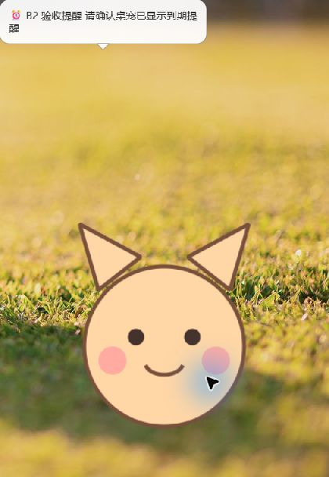

# B2 / A4 联调验收记录（2026-10-12）

> 更新：用户随后授权统一修复 B2 与 A4，修复后本轮验收已通过，见 [最新结果](b2-final-acceptance.md)。
> 以下保留首次失败记录，不代表最新代码仍有相同问题。

**结论：基础链路通过，完整验收未通过；保留 PR #21 待评审状态。**
被测业务代码 `f98d82df138b4df6131537d26d3f9244756b2d5d`，
对应 [B2 #6](https://github.com/Yunkimo/IDP/issues/6)、[A4 #4](https://github.com/Yunkimo/IDP/issues/4)、
[PR #21](https://github.com/Yunkimo/IDP/pull/21)。本次为用户要求的工具验收，不冒充另一成员的人工审批。

## 结果

| 项目 | 实际结果 | 判定 |
|---|---|---|
| 后端自动化 | 63 项通过，1 条既有 Starlette 弃用提示，5.34 秒 | 通过 |
| 桌宠自动化 | 84 项通过，Windows / Python 3.13 | 通过 |
| 1 秒扫描、30 条真实 WS 提醒 | 30/30，零超时/重复、done 全部为 1；p50/p95/max 190.935/1005.892/1017.326 ms | 通过（收包层） |
| 真实桌宠普通到期提醒 | lead=10 秒；到期后 1.720 秒进入气泡绘制回调；正文一致，done=1；工具截图确认气泡显示 | 单次功能通过；不是 30 次 GUI SLA 验收 |
| 原 #6：lead=60 秒、默认扫描 30 秒 | 正常窗口启动组从创建 88.502 秒、从到期 28.502 秒；done=1 | 按“创建起 60 秒内”不通过 |
| 后端发送后、写回前失败恢复 | 租约到期重试相同 event_id，最终 done=1 | 后端恢复通过 |
| 桌宠重复事件去重 | 相同 event_id 收到两次、气泡处理及绘制两次 | 不通过 |
| 语音、微信真机、跨机器延迟 | 未执行 | 未验 |

自动化原始记录：[后端](evidence/b2/acceptance-backend-tests.txt)、
[桌宠](evidence/b2/acceptance-desktop-tests.txt)、[30 条 WS](evidence/b2/acceptance-ws-30samples.json)。
桌宠配置仍是项目现有未锁定依赖范围；本次实际安装版本另存 [环境清单](evidence/b2/acceptance-desktop-packages.txt)。

## 两项未通过原因

1. **验收计时口径仍未定案。** 默认 30 秒轮询无法保证所有创建相位在创建后第 60 秒收到一个
   第 60 秒才到期的提醒。本次原样执行，实际 88.502 秒，不能用“最终收到”判通过。
   Issue #6 已有 [口径讨论](https://github.com/Yunkimo/IDP/issues/6#issuecomment-6109271396)。
   需 A/B/C 确认计时起点、容差与配置，之后按确认条件重验；当前不自行改写原条件。
2. **A4 未按 event_id 去重。** `pet/window.py` 的 `_on_backend_event` 对每个 reminder.due
   都调用 `_remind_health`，未检查 event_id。本次在独立后端进程中仅注入一次
   `reminder_store.finish` 异常，位置是实际 WS 发送后、状态写回前。
   租约设为 3 秒，实际收到两条同 ID 事件；到期后约 1.432 秒和 4.060 秒各绘制一次气泡。
   后端重试符合已记录契约，客户端需要有界去重并增加重复事件用例。
   本次关闭语音，因此只证明重复展示；未声称实际听到重复播报。

去重失败原始记录：[恢复联调 JSON](evidence/b2/acceptance-recovery-gui.json)。
本轮不修改 A 业务模块，不代替 A/C 接口评审，也不合并 PR 或关闭议题。

## 界面证据与测量限制



截图来自真实 PetWindow。检查到的文字为“B2 验收提醒 请确认桌宠已显示到期提醒”。
实际链路为临时 SQLite → Scheduler → WS → 原 WsListener → 原 PetWindow → REST 正文校正 → SpeechBubble。
没有伪造 WS 消息或替换提醒处理函数。绘制回调时间是应用事件循环观测值，不代表显示器像素亮起的精确时刻；
截图单独确认视觉输出，不能拿截图获取时刻推算精确延迟。

- 原 Qt Tool 窗口不被本机截图工具枚举；前两次默认组仍保留原窗口类型，通过 Qt 绘制回调记录。
- 为取得视觉证据，快速组与恢复组通过 `--capture-window` **仅在测试进程**取消 Tool 标志；
  未改动 `pet/window.py`。这验证实际气泡内容，但不等同于生产窗口置顶/遮挡行为验收。
- 首次截图被屏保遮挡，激活验收窗口后取得上图；不把遮挡时的截图算作气泡显示证据。
- 使用内置占位猫、关闭聊天调用、语音和久坐提醒；不下载 ASR 模型、不使用真实业务数据。
- 无个人配置文件改动；随机临时凭证未写入证据，测试完成后后端进程与临时库均清理。
- 默认组两次记录均保留：[首次组](evidence/b2/acceptance-default-gui.json)（创建后 88.943 秒）、
  [正常启动组](evidence/b2/acceptance-default-visible.json)（创建后 88.502 秒）；未挑选“压线”样本。
- [快速组](evidence/b2/acceptance-fast-gui.json) 是单条 GUI 样本；30 条分布数据属于 WS 收包层，不能混用。

## 复现

Windows 下安装根目录 requirements-dev.txt 到 `.venv`，后端环境沿用 backend/.venv。
在仓库根目录直接运行以下 Python 命令（需要可见桌面；验收窗口会自行关闭）：

```powershell
.venv/Scripts/python scripts/acceptance_reminder_gui.py --interval 30 --lead 60 --hold 25 --output tmp/accept-default.json
.venv/Scripts/python scripts/acceptance_reminder_gui.py --interval 1 --lead 10 --hold 45 --capture-window --output tmp/accept-fast.json
.venv/Scripts/python scripts/acceptance_reminder_gui.py --interval 1 --lead 5 --hold 25 --capture-window --fail-first-commit --output tmp/accept-recovery.json
```

脚本退出成功仅检查“收到、发生绘制、done=1”的基础链路；验收口径及去重结论须检查 JSON 中的
`from_created_seconds`、`from_due_seconds`、`duplicate_events`，本报告已明确判失败，不能仅凭退出码判完整通过。
故障注入仅用于模拟发送后写回中断，不是操作系统强制断电测试。

后续：先解决 A4 去重并确认时间口径，再补复验；语音、其他成员干净部署/恢复与微信保持未验。
