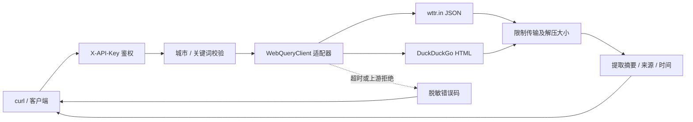

# B4 天气与搜索接口

关联 [Issue #8](https://github.com/Yunkimo/Intelligent-Desktop-Pet/issues/8)。本次提供可由 curl、桌宠或小程序调用的后端摘要接口。起始基线 `42a95ba`；B3 PR #29 尚待合并，因此使用独立分支 `feat/backend-web-query`，不把 B4 加入 B3 的 PR。

## 实现位置与协作决定

用户明确要求实施原可选 B4，且验收要求 curl 返回摘要，因此将新增公共契约放在后端。现有 A2 的 `pet/tools.py` 已有本地天气和搜索；本次不更换它的调用路径、不新增桌面工具，不引入后端对 PyQt 或桌面包的依赖。A/C 可按以下契约接入；是否将桌面本地实现迁移到后端由接口 PR 评审确认，当前没有声称取得 A 的独立评审或完成桌面接入。



新增后端代码使用现有 httpx 和标准库，无新增运行依赖或数据库迁移。路由负责鉴权/输入，适配器负责网络、解析和资源边界，响应模型负责跨端契约。通过注入 transport 测试失败路径；没有为本功能建立新的业务数据源。

## 启动与 curl

在后端虚拟环境、仓库根目录执行（已有 `.env` 不要覆盖）：

```powershell
python -m pip install -r backend/requirements-dev.txt
python -m uvicorn app.main:app --app-dir backend --host 127.0.0.1 --port 8000 --workers 1
```

后端读取 `backend/.env` 的 `API_TOKEN`。下面的 `$env:API_TOKEN` 需在当前终端设置为相同值；不要把真实值粘贴到文档或截图。Windows 使用 `curl.exe`，Linux 将其换为 `curl` 并使用对应 shell 的环境变量语法。

```powershell
curl.exe --fail-with-body --get "http://127.0.0.1:8000/api/tools/weather" -H "X-API-Key: $env:API_TOKEN" --data-urlencode "city=Beijing"
curl.exe --fail-with-body --get "http://127.0.0.1:8000/api/tools/search" -H "X-API-Key: $env:API_TOKEN" --data-urlencode "q=Python asyncio official documentation" --data-urlencode "limit=3"
```

免上游 key 不等于免后端鉴权。共享 API Key 继续适用于受信任演示；公网部署仍需 HTTPS、访问控制与网关限流。

## 接口契约

| 接口 | 参数 | 约束 |
|---|---|---|
| `GET /api/tools/weather` | `city` 必填 | 1–80 字符，支持中文、字母、空格及地名标点；不接受 URL、IP、控制字符或 wttr 特殊命令 |
| `GET /api/tools/search` | `q` 必填，`limit` 默认 3 | q 为 1–200 字符，禁止控制/格式字符；limit 为 1–5 |

两接口返回统一 JSON，`summary` 是可直接显示的摘要文本：

| 字段 | 含义 |
|---|---|
| `status` | `ok`；搜索确实无结果为 `empty` |
| `query` | 校验并规范空白后的城市或关键词 |
| `provider` | `wttr.in` 或 `DuckDuckGo` |
| `summary` | 天气描述/摄氏温度/体感/湿度，或搜索标题、摘要和链接 |
| `source_url` | 公共来源入口；后端不会访问搜索结果链接 |
| `fetched_at` | 本次请求完成时间，带时区 UTC |
| `observed_at` | 天气上游提供的原始观测时间；搜索为 null |
| `results` | 搜索的 `{title,url,snippet}` 数组；天气为空数组 |

天气摘要显示上游实际解析的位置，不能假设任意输入都被准确定位。上游有时只提供不含日期的时间，原样保留，不将其误写为本次查询时间。搜索摘要是网页片段，不是模型生成事实；客户端应使用纯文本组件显示，并将其视为不可信引用，不能作为系统指令执行。

成功响应使用 `Cache-Control: no-store`。本功能不缓存或持久化查询；按需调用，避免频繁轮询。

| HTTP | 错误或行为 |
|---|---|
| 401 | 缺失或错误的 X-API-Key |
| 422 | 参数不合法，不访问上游 |
| 502 | 网络失败、非成功 HTTP、结构变化、异常链接页、超大响应、编码或压缩损坏 |
| 503 | 后端 API Key 未配置，或上游返回 202/403/429、验证码页面 |
| 504 | 总请求超时，包括等待并发槽位及读取响应 |

业务失败体为 `{"detail":"稳定错误码"}`，例如 `upstream_timeout`、`search_challenge`、`weather_invalid_response`。不返回上游正文、异常 URL 或代理凭证。无搜索结果是 200/empty；验证码或页面结构变化不能冒充空结果。

## 配置与资源限制

| 环境变量 | 默认 | 含义 |
|---|---:|---|
| `WEB_QUERY_TIMEOUT_SECONDS` | 8 | 正有限秒数，总网络操作期限 |
| `WEB_QUERY_MAX_BYTES` | 262144 | 原始传输及解压后分别限制，允许 1024–1048576 字节 |
| `WEB_QUERY_MAX_CONCURRENT` | 4 | 单进程并发上游请求数，允许 1–16 |

目标地址集中定义在 config，固定为 HTTPS 的 wttr.in 与 html.duckduckgo.com，不接受调用者指定 URL，不跟随重定向；TLS 校验保持启用。只解码 gzip/deflate/identity，分块解压时就限制输出，拒绝损坏或附加压缩数据。没有自动重试；超时释放槽位，上游拒绝时直接报告。

搜索标题最多 200 字符、片段 500 字符、链接 2048 字符，结果去重并限制数量。丢弃非 HTTP(S)、内网 IP、localhost、携带账号口令等危险链接；不抓取结果页面，因此不会把关键词或链接变成任意网络请求。解析器依赖 DuckDuckGo HTML 结构，不是稳定的商业搜索 API，结构变化时需更新适配器和用例。

上游客户端遵循受信任服务器环境中的标准代理设置。示例不保存代理凭证；反向代理、系统代理与 DEBUG 网络日志需由部署者管理。Uvicorn/httpx 查询参数日志经过过滤；城市会出现在 wttr 的路径中，故不能宣称所有访问日志都不含地名。

## 自动验收与真实网络验收

```powershell
# 真实 Uvicorn + curl + Mock 上游，CI 使用，不依赖公网
python scripts/smoke_backend_web_query.py --output tmp/b4-mock.json
# 显式访问真实公共服务，成功/失败均记录，失败退出非零
python scripts/smoke_backend_web_query.py --live --output tmp/b4-live.json
```

需要现有受信任出口代理时，可在第二条命令增加 `--proxy <代理地址>`，仅影响验收子进程。脚本创建临时 SQLite、随机凭证和随机本机端口；凭证通过临时 curl 配置文件传递，结束后清理。不会改写个人 `.env` 或数据库。

结果与限制见 [B4 测试报告](b4-test-report.md)。真实天气/搜索已分别返回摘要，但公共服务可能拒绝后续请求；不据一次成功承诺可用率。

实现依据：[wttr.in 官方 README 的 JSON 格式](https://github.com/chubin/wttr.in#json-output)、[DuckDuckGo 官方非 JavaScript 搜索说明](https://duckduckgo.com/duckduckgo-help-pages/features/non-javascript)。官方页面说明了服务入口；HTML 选择器来自实际返回页面，并通过测试固定当前契约。
